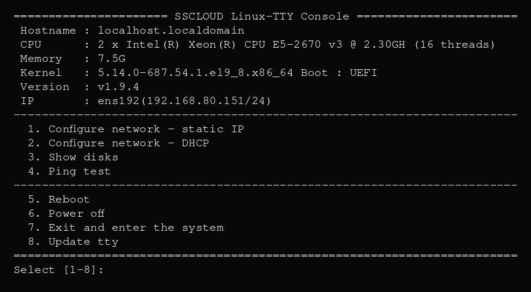

# cetnos-tty

**SSCLOUD CentOS7-TTY** —— 无显示器 Linux 设备的物理控制台菜单。单文件 Go 静态二进制，开机跑在物理 `tty1` 上，无需登录即可按键配置网络、Ping、查看磁盘、重启/关机。



## 菜单

| 按键 | 功能 |
|------|------|
| 1 | 静态 IP（自动备份原 ifcfg） |
| 2 | DHCP |
| 3 | 数据盘列表（整盘，自动排除系统盘） |
| 4 | Ping 223.6.6.6 |
| 5 | 重启 |
| 6 | 关机 |
| 7 | 进入系统（getty 账号密码登录） |
| `666` | 隐藏：免密进入 root shell（菜单不显示） |

任意输入框按 `Ctrl+C` / `ESC` 回主菜单。

## 编译

```bash
CGO_ENABLED=0 GOOS=linux GOARCH=amd64 go build -ldflags="-s -w" -o cetnos-tty .
```

纯静态，无外部依赖，CentOS 7+ x86_64，约 2.4 MB。

## 部署

二进制传到目标机后，root 粘贴整段：

```bash
set -e
install -m 0700 /usr/local/sbin/cetnos-tty /usr/local/sbin/cetnos-tty

cat > /etc/systemd/system/cetnos-tty@.service <<'EOF'
[Unit]
Description=SSCLOUD CentOS7-TTY Console
After=systemd-user-sessions.service plymouth-quit-wait.service
Before=getty.target
Conflicts=getty@tty1.service cetnos-root@tty1.service
[Service]
ExecStart=/usr/local/sbin/cetnos-tty
Restart=always
RestartSec=0
StandardInput=tty
StandardOutput=tty
StandardError=tty
TTYPath=/dev/tty1
KillMode=process
[Install]
WantedBy=multi-user.target
EOF

mkdir -p /etc/systemd/system/getty@tty1.service.d
cat > /etc/systemd/system/getty@tty1.service.d/override.conf <<'EOF'
[Service]
ExecStopPost=/usr/bin/systemctl start cetnos-tty@tty1.service
EOF

# 隐藏 666 免密入口（不需要可删）
cat > /etc/systemd/system/cetnos-root@.service <<'EOF'
[Unit]
Description=Root shell autologin (hidden)
After=systemd-user-sessions.service
[Service]
ExecStart=-/sbin/agetty --autologin root --login-program /usr/local/sbin/cetnos-root-shell --noclear %I linux
Restart=no
StandardInput=tty
StandardOutput=tty
StandardError=tty
TTYPath=/dev/%I
KillMode=process
ExecStopPost=/usr/bin/systemctl start cetnos-tty@%i.service
[Install]
WantedBy=multi-user.target
EOF
echo -e '#!/bin/bash\n/bin/bash -l' > /usr/local/sbin/cetnos-root-shell
chmod 700 /usr/local/sbin/cetnos-root-shell

echo 'kernel.sysrq = 0' > /etc/sysctl.d/99-cetnos-tty.conf
sysctl -w kernel.sysrq=0
systemctl daemon-reload
systemctl enable --now cetnos-tty@tty1.service
```

## 安全

- 二进制 `0700 root:root`，必须 root 运行。
- `666` 是隐藏免密 root 入口，物理控制台任何人输入即得 root，**仅在物理访问受控的设备上启用**；不需要时删掉 `cetnos-root@.service` 和 `cetnos-root-shell` 即可关闭。

## 卸载

```bash
systemctl disable --now cetnos-tty@tty1.service
rm -f /etc/systemd/system/cetnos-tty@.service /etc/systemd/system/cetnos-root@.service
rm -f /usr/local/sbin/cetnos-root-shell /usr/local/sbin/cetnos-tty
rm -rf /etc/systemd/system/getty@tty1.service.d
systemctl daemon-reload
```
